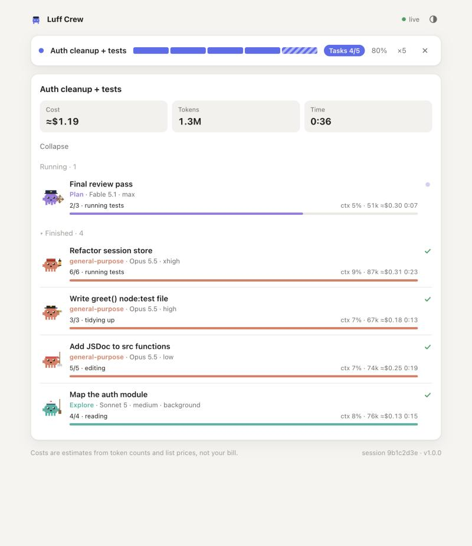

# Luff Crew Monitor

**See what every helper Claude is doing, and what it costs, live.**

An MCP server for Claude Code. When Claude splits work across subagents, Luff Crew gives you a live dashboard of the whole crew: who's running, who's finished, what's still planned, and for each one the model, effort, step progress, context fill, estimated cost and time.



- **Job bar**: the job's title, phase, accepted tasks out of planned (one segment per task), percent done and crew size.
- **Agents panel**: Running, Finished and Planned sections with cost, token and time totals. Each subagent gets a pixel deckhand whose gear shows its effort level: mop, oar, spyglass, lantern or ship's wheel.
- **Worker steps**: subagents report their own steps (`2/5 · running tests`). A subagent that doesn't report shows its context fill in grey instead.
- **Works with any subagent**: built-in, custom or plugin agents, foreground or background, retries counted as rounds.
- **`/agents-info`** opens the panel. There's also an optional status-line segment for the terminal.
- **Private by design**: it reads your local Claude Code transcripts read-only, serves the dashboard on `localhost` only, and has no telemetry and no runtime dependencies.

## Install

Requires Node 18.17+ and Claude Code.

**Option A: Claude Code plugin (recommended).** Run inside Claude Code:

```
/plugin marketplace add tanwar-harsh/luff-crew-monitor
/plugin install luff-crew-monitor@luff-crew
```

That's it. The MCP server and `/agents-info` come with the plugin.

**Option B: MCP server + setup command.** From your terminal:

```bash
npm install -g https://codeload.github.com/tanwar-harsh/luff-crew-monitor/tar.gz/refs/heads/main
```

```bash
luff-crew-monitor setup
```

`setup` registers the server with `claude mcp add` (user scope) and adds `/agents-info`. Add `--statusline` to also put the job bar in Claude Code's status line. If you already have a status line, it keeps running and Luff Crew is appended to it.

**Option C: any MCP client, configured by hand.**

```json
{
  "mcpServers": {
    "luff-crew": { "command": "npx", "args": ["-y", "github:tanwar-harsh/luff-crew-monitor"] }
  }
}
```

Restart Claude Code (or run `/mcp`) after installing. Run `luff-crew-monitor doctor` if anything looks off.

## Use

1. Give Claude a job big enough to split across a few subagents.
2. Type `/agents-info`, or just watch: the dashboard opens on its own when a job with a plan starts.

You don't need to prompt anything special. The server's built-in instructions tell Claude when to report progress and to ask its subagents for steps. If you want the job bar to be precise, say "plan it as tasks for subagents" in your request.

## Tools

| Tool | Who calls it | What it does |
| --- | --- | --- |
| `progress` | Orchestrator | Reports the job: `title`, `tasks[]` (`title`, `agent`, `model`, `effort`, `after`), `phase` (`plan`, `design`, `delegate`, `review`, `close`), `done`, `total`, `finished`. Omitted fields keep their value. A new title starts a new job. |
| `step` | Subagent | Reports its own steps: `done`, `total`, `note`. |
| `crew_status` | Anyone | Returns the crew as text. |
| `open_dashboard` | Anyone | Opens the dashboard and returns its URL. |
| `agents-info` *(prompt)* | You | Same as the slash command. |

Planned tasks match runs by title, so each task's `title` should equal the Agent tool `description` it's delegated with.

## Configure

Everything is optional. Settings live in `~/.luff-crew/config.json`; environment variables take precedence.

| Setting | Env var | Default | |
| --- | --- | --- | --- |
| `port` | `LUFF_CREW_PORT` | `7420` | First port to try. If it's taken, the next free one is used. |
| `language` | `LUFF_CREW_LANG` | `auto` | `en` or `ru`. `auto` follows Claude Code's `language` setting, then your locale. |
| `autoOpen` | `LUFF_CREW_AUTO_OPEN` | `true` | Open the browser when a job with a plan starts. |
| `stallMinutes` | `LUFF_CREW_STALL_MINUTES` | `30` | A run silent this long, with no end, is marked stalled. |
| `prices` | | built in | `{ "model-substring": [input, 5m write, 1h write, cache read, output] }` in USD per million tokens. |
| `contextWindows` | | built in | `{ "model-substring": tokens }` |

## CLI

```
luff-crew-monitor                 MCP server over stdio (what Claude Code runs)
luff-crew-monitor setup           Register + /agents-info  [--statusline] [--scope user|project|local] [--force] [--dry-run]
luff-crew-monitor dashboard       Dashboard without Claude, following the latest session  [--project <dir>] [--session <id>] [--port <n>] [--no-open]
luff-crew-monitor status          Print the crew once as text
luff-crew-monitor statusline      Status line command  [--wrap "<existing command>"] [--no-color]
luff-crew-monitor doctor          Check the installation
luff-crew-monitor uninstall       Undo setup
```

## How it works

Claude Code writes every session to `~/.claude/projects/<project>/<session>.jsonl`, and each subagent to its own transcript beside it. Luff Crew tails those files incrementally. It picks up Agent launches, results and background-task notifications from the main thread, and model, effort, token usage and `step` calls from each subagent. Then it streams a snapshot to the dashboard over server-sent events. The `progress` and `step` calls are recorded in those same transcripts, which is how a step gets attributed to the right worker.

## Good to know

- **Costs are estimates.** They're computed from token counts and public list prices (including cache reads, and 5-minute vs 1-hour cache writes), not taken from your bill. Subscription plans aren't billed per token at all.
- **Local only.** The server needs your machine's transcripts, so it runs locally (stdio). It can't be added as a claude.ai web connector, because a remote server can't see your local Claude Code sessions.
- **Claude Desktop chat** has no subagents. The tools work there, but the panel only shows job progress.
- The dashboard binds to `127.0.0.1`, rejects foreign `Host` headers and uses a strict CSP. Nothing leaves your machine.

## Development

```bash
npm install
```

```bash
npm run check
```

```bash
npm run demo
```

`check` runs typecheck, build and tests. `demo` runs a simulated crew, with no tokens spent. The bundle in `dist/` is committed so plugin installs need no build step. Run `npm run build` before committing source changes.

## License

[MIT](LICENSE) © 2026 Harsh Tanwar
