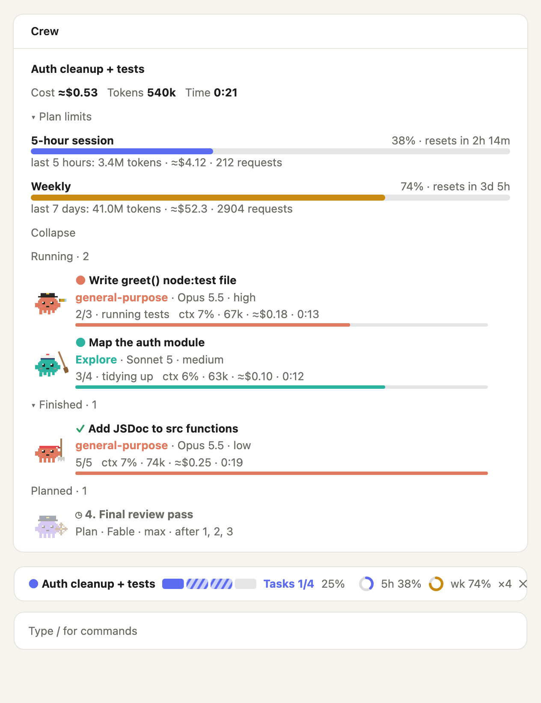
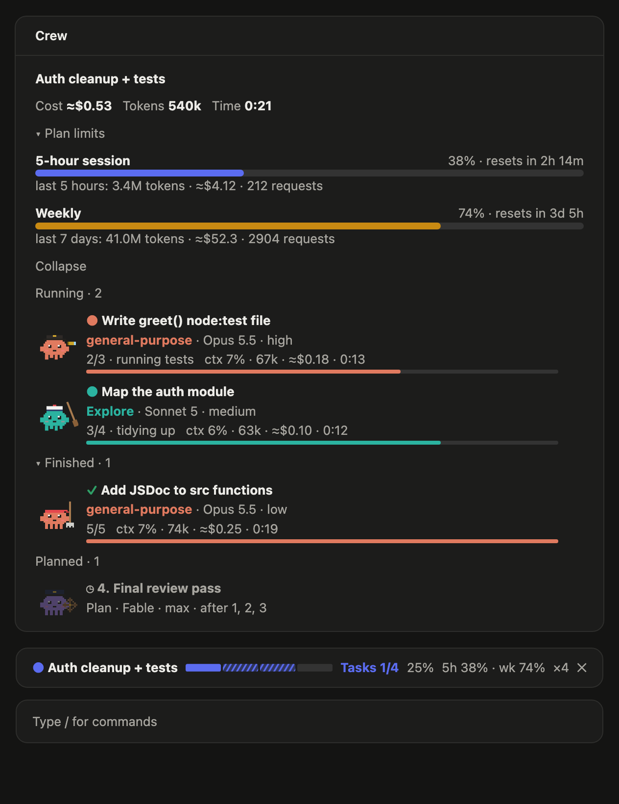
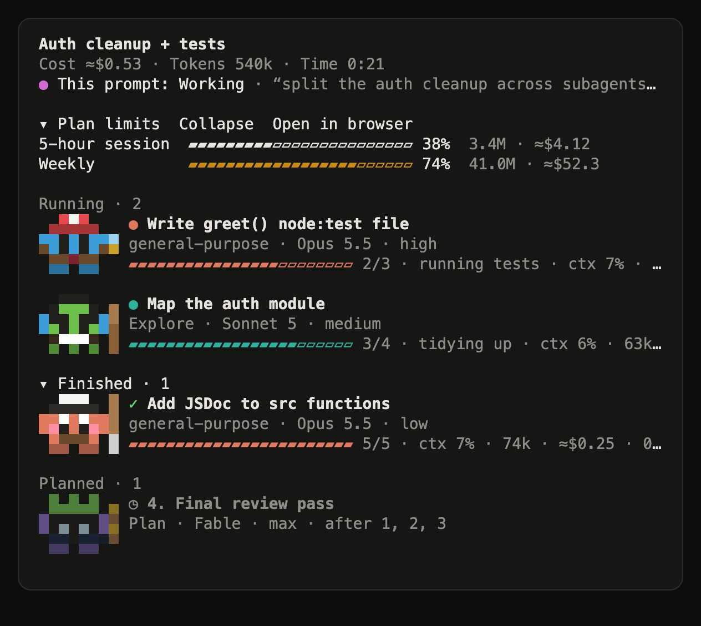
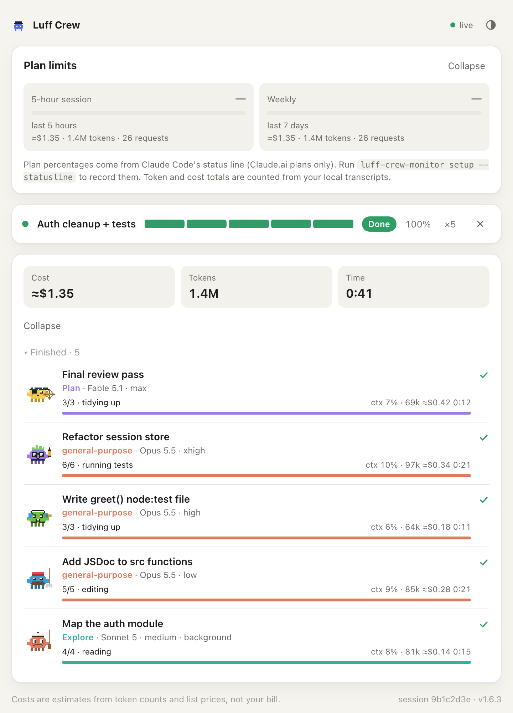
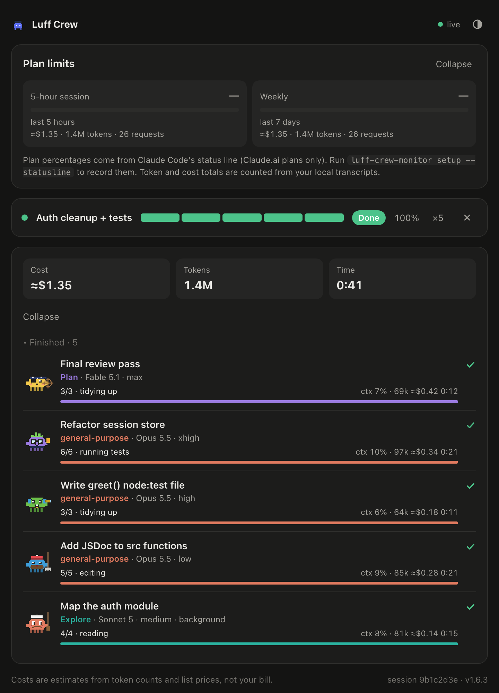

# Luff Crew Monitor

**See what every helper Claude is doing, and what it costs, live.**

A Claude Code mod: it draws **inside Claude itself** (the desktop app, VS Code and the terminal). When Claude splits work across subagents, Luff Crew gives you a live panel of the whole crew: who's running, who's finished, what's still planned, and for each one the model, effort, step progress, context fill, estimated cost and time. A job bar sits above the prompt, and your 5-hour and weekly plan limits are always one glance away.

<p align="center">
  
  
</p>
<p align="center">
  
</p>

- **Job bar on every prompt**: while Claude works on anything, the bar above the prompt shows what you asked, one segment per model request, tool calls (and the one running now), elapsed time and estimated cost, then Done or Stopped. When Claude splits the work across subagents it becomes the job bar: title, phase, accepted tasks out of planned (one segment per task), percent done and crew size. Your 5-hour and weekly limits sit at its right edge as colored rings.
- **Agents panel**: Running, Finished and Planned sections with cost, token and time totals. Each subagent is its own pixel crew member, with a body color, hat, eyes, mouth and extra of its own, kept from planned to done; what it holds shows its effort level: mop, oar, spyglass, lantern or ship's wheel. The terminal draws the same crew in colored half blocks, three lines tall.
- **Worker steps**: subagents report their own steps (`2/5 · running tests`), as often as the `stepReports` option asks (see Configure). A subagent that doesn't report shows its context fill in grey instead.
- **Works with any subagent**: built-in, custom or plugin agents, foreground or background, retries counted as rounds.
- **Plan limits**: your 5-hour session and weekly usage, with % used and when each resets, above the agents. Under each meter, the tokens, estimated cost and requests counted from your local transcripts for that window.
- **`/agents-info`** opens or closes the panel. It also opens on its own when a job with a plan starts, or when the first subagent of a session starts.
- **Optional browser view**: `/agents-web` opens the same crew in your browser on `localhost`, for when you want it on a second screen. It never opens by itself.
- **Private by design**: everything stays on your machine. No telemetry; the browser view listens on `localhost` only and only while you have it on.

## Install

In a terminal, run:

```
/plugin install luff-crew-monitor --marketplace tanwar-harsh/luff-crew-monitor
```

Answer `y` to add the marketplace and pick the **user** scope. From then on it runs in every session: terminal, desktop app and VS Code. (The desktop app's Code tab can't run `/plugin`, but a mod installed from a terminal loads there too.)

Or, from your shell:

```bash
claude plugin marketplace add tanwar-harsh/luff-crew-monitor
```

```bash
claude plugin install luff-crew-monitor@luff-crew
```

Requires Claude Code 2.1.295 or newer. Run `claude update`; the desktop app updates itself.

### Update

Already installed? Pull the latest version, then restart Claude (or run `/reload-plugins`):

```bash
claude plugin update luff-crew-monitor@luff-crew
```

### Without the mod: MCP server and browser dashboard

For other MCP clients, the same tracker also ships as a standalone MCP server with a browser dashboard on `localhost`:

```bash
npm install -g https://codeload.github.com/tanwar-harsh/luff-crew-monitor/tar.gz/refs/heads/main
```

```bash
luff-crew-monitor setup
```

Don't use both in Claude Code: the mod already provides the same tools.

## Use

1. Send Claude anything. The bar above the prompt follows the turn: steps, tool calls, time and estimated cost.
2. Give it a job big enough to split across a few subagents and the bar becomes the job bar. Type `/agents-info` to open the panel.

### Browser view (optional)

Inside Claude is the default and needs nothing. If you'd also like the crew in a browser tab:

<p align="center">
  
  
</p>

| Command | What it does |
| --- | --- |
| `/agents-web` | Starts the browser view for this session on `localhost` (port 7420, or the next free one) and opens it. Run it again to reopen the tab. |
| `/agents-web stop` | Stops it. It also stops when the session ends. |

The panel's *Open in browser* button does the same. The browser view needs Node.js 18.17 or newer on your machine; it's the package's own dashboard (`dist/luff-crew.mjs`) following this session's transcript.

You don't need to prompt anything special. The mod adds a short note to Claude's system prompt so it reports progress and asks its subagents for steps. If you want the job bar to be precise, say "plan it as tasks for subagents" in your request.

## Plan limits

The panel at the top tracks the two Claude.ai plan windows: the **5-hour session** and the **weekly** limit.

- **% used and reset time** come straight from Claude Code (the same figures as its status line), after your first reply in a session. The meters turn amber past 70% and red past 90%.
- **On the job bar** the same two windows sit at the right edge, beside the crew count, as small rings in the same colors. The terminal shows them as colored text (`◔ 5h 38%`).
- **Tokens, estimated cost and requests** for each window are counted from every model request the mod sees, across your sessions and their subagents.

Plan percentages exist only for Claude.ai subscriptions (Pro, Max, Team, Enterprise). With an API key, Bedrock or Vertex the meters stay empty and the local totals cover the last 5 hours and 7 days.

## Tools

The mod gives Claude two tools. The note it adds to the system prompt tells Claude when to call them.

| Tool | Who calls it | What it does |
| --- | --- | --- |
| `mcp__luff-crew-monitor__progress` | Orchestrator | Reports the job: `title`, `tasks[]` (`title`, `agent`, `model`, `effort`, `after`), `phase` (`plan`, `design`, `delegate`, `review`, `close`), `done`, `total`, `finished`. Omitted fields keep their value. A new title starts a new job. |
| `mcp__luff-crew-monitor__step` | Subagent | Reports its own steps: `done`, `total`, `note`. |

Planned tasks match runs by title, so each task's `title` should equal the Agent tool `description` it's delegated with.

## Configure

Two options, set with `/plugin configure luff-crew-monitor@luff-crew` or in `~/.claude/settings.json`:

- `language`: `auto` (the default) follows Claude Code's `language` setting, then your locale. `en` and `ru` are available.
- `stepReports`: how often subagents report their own steps. Each report is one more model request in the subagent, so this is the mod's main cost.
  - `light` (the default): twice per subagent, at the start and about halfway.
  - `full`: after every step, for the most detailed rows.
  - `off`: never; the `step` tool is not even registered. Rows still show running/done, model, context, tokens, cost and time, only not "2/4 · reading files".

  Step reports only feed the panel. The main agent learns what a subagent did from the subagent's own answer either way.

```json
{ "pluginConfigs": { "luff-crew-monitor@luff-crew": { "options": { "language": "en", "stepReports": "off" } } } }
```

## How it works

The mod is a hooks module (`hooks/register.tsx`) that Claude Code loads into every session:

- `agent.spawn`, `turn.step` and `turn.complete` give it each subagent's start, model, effort, token usage and end. Cost comes from token counts and the price table in `src/pricing.ts`.
- `session.measure` gives the 5-hour and weekly plan windows.
- `tool.call` answers `progress` and `step`. A subagent's call carries its loop's id, which is how its steps land on the right row.
- `turn.start`, `turn.step` and `turn.complete` on the main loop drive the per-prompt bar.
- A `Pane` and an `AbovePrompt` render hook draw the panel and the bar. Words are the app's own themed text. Mascots, bars and limit rings are small SVGs (desktop, VS Code) or text (terminal).
- `/agents-web` runs `node dist/luff-crew.mjs dashboard --session <id>` as a child of the session (`$.process.spawn`); the child ends with the session or on `/agents-web stop`.

Inside Claude it needs no server, no browser and no network.

## Good to know

- **Costs are estimates.** They're computed from token counts and public list prices (including cache reads, and 5-minute vs 1-hour cache writes), not taken from your bill. Subscription plans aren't billed per token at all.
- **Plan limits** appear after Claude's first reply in a session. They're Claude.ai plans only.
- **Where it draws:** the desktop app's Code tab, the VS Code extension and the terminal. In the terminal's main screen the panel opens inline. In the fullscreen layout it docks as a sidebar.

## Standalone CLI and MCP server

The package also ships a CLI that reads Claude Code's transcripts directly. It's for other MCP clients, or a browser view outside Claude.

```
luff-crew-monitor                 MCP server over stdio
luff-crew-monitor setup           Register it with `claude mcp add`  [--statusline] [--scope user|project|local] [--force] [--dry-run]
luff-crew-monitor dashboard       Browser dashboard following the latest session (or one: --session <id>)  [--project <dir>] [--session <id>] [--port <n>] [--no-open]
luff-crew-monitor status          Print the crew once as text
luff-crew-monitor statusline      Status line command  [--wrap "<existing command>"] [--no-color]
luff-crew-monitor doctor          Check the installation
luff-crew-monitor uninstall       Undo setup
```

Its settings live in `~/.luff-crew/config.json`, or in `LUFF_CREW_PORT`, `LUFF_CREW_LANG`, `LUFF_CREW_AUTO_OPEN`, `LUFF_CREW_STALL_MINUTES` and `LUFF_CREW_STEP_REPORTS`. `stepReports` (`off`, `light` or `full`, default `light`) works as the mod's option of the same name: how often subagents are asked to report their steps, and with `off` the `step` tool isn't offered. `autoOpen` is off by default: the MCP server opens the browser only when its `open_dashboard` tool is called. Set it to `true` to have the dashboard open by itself when a job with a plan starts.

## Development

```bash
npm install
```

```bash
npm run check
```

```bash
claude plugin test .
```

```bash
claude plugin validate .
```

- `npm run check` runs the typecheck, the build and the Node tests (`test/*.spec.ts`).
- `claude plugin test .` runs the mod's own tests (`hooks/*.test.tsx`) against the engine, on the terminal and desktop surfaces.
- `node scripts/mod-preview.ts light|dark` renders the panel and job bar as HTML for the screenshots in `docs/`.
- To work on the mod live, start Claude Code with `claude --plugin-dir .`. Edits reload when a turn ends.
- The CLI bundle in `dist/` is committed so installs need no build step. Run `npm run build` before committing source changes.

## License

[MIT](LICENSE) © 2026 Harsh Tanwar
